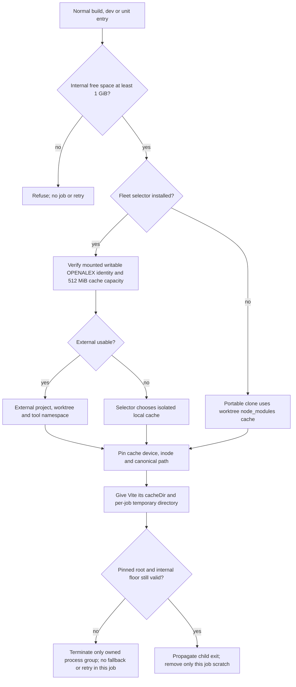

<!-- For God so loved the world, that he gave his only begotten Son, that whosoever believeth in him should not perish, but have everlasting life. — John 3:16 (KJV) -->

# Web compiler cache selection

Implemented by `scripts-chirho/build-cache-chirho/select_chirho.ts` and `run_chirho.ts`. Normal `bun run build`, `bun run dev` and `bun run test:unit` select once per invocation. The shared fleet selector is resolved from the account's `bin-chirho/build-cache-chirho`; the project namespace is `audiobibleradio-chirho`, tool `vite-chirho`, and the canonical worktree determines the isolated shard. Separate build, dev and unit leaves prevent those profiles sharing optimizer writes.

The wrapper passes `RADIO_VITE_CACHE_CHIRHO` to Vite's supported `cacheDir` option. Its name deliberately avoids the public `VITE_` prefix. Child `TMPDIR`, `TMP` and `TEMP` use an invocation-specific directory under the selected cache. Only ordinary OS/tool variables and explicitly public Vite/Svelte configuration are inherited; provider credentials are not passed to the compiler child. This is for this public project's regenerable compiler cache and synthetic tests, not private/signing/customer workloads.

The shared selector performs mounted-volume UUID, writability, namespace and capacity checks. A real external refusal selects its existing account-local namespace. A clone without the fleet selector uses its own `node_modules/.cache-chirho/build-chirho`. Selection failure with an installed selector is a hard failure, not permission to bypass its admission. `RADIO_CACHE_SELECTOR_CHIRHO` is an explicit absolute executable override for controlled tests. The adapter never creates parent directories under a missing mount, migrates cache trees or changes the volume's ownership/encryption.

The running child is checked every 250 ms for cache-root device/inode/path changes and the 1 GiB internal floor. Loss sends TERM to the owned process group, followed by KILL after two seconds if needed. The backend stays pinned; only the next separate invocation may select local storage. This is bounded detection, not an assertion that a physical removal was exercised or that a tool cannot attempt a write between polls.

Keep framework-required small generated `.svelte-kit` configuration, the verified worker output, local `.wrangler` state, environment files, credentials, release/rollback bytes and evidence in their existing safe locations. `env:local` and worker type checking keep their small local paths. Preview and Wrangler state are not moved. Dependency installation and native caches are outside this adapter. The initial adapter adoption preserved the old optimizer cache. Separate owner authority root1464 later cold-retired only the unused worktree and account-local fallback optimizer leaves; the external warm cache, fallback namespace marker and protected outputs remain. See `spec-chirho/tasklists-chirho/26-11-14_11-47-tasklist-retire_unused_caches-chirho.md`. A later LOCAL fallback rebuilds its optimizer cache cold.

## Verification and current scope

`bun scripts-chirho/build-cache-chirho/verify_chirho.ts` runs seven tiny synthetic controls: insufficient internal capacity refuses admission; selected cache/temp reach the child without a private sentinel; completed scratch is removed; exit failure propagates; a portable clone works without the global helper; disappearance stops the owned child; and no mountpoint or automatic fallback is created. All fixture directories are owned and removed. They do not disconnect or chmod the shared drive.

Adoption additionally exercised the normal build selection probe on real OPENALEX and on the actual shared selector with its mounted-volume check simulated as missing/read-only, plus a permission-denied external namespace write. Each refusal selected LOCAL without altering the live drive. Focused normal unit tests ran on external and simulated-missing local cache paths. Both passed; job scratch was removed. The existing 420 protected prepared-worker/dry-run files retained the same inventory hash, and the existing preview still answered 200. Per-file output and exact local paths are in the private adoption result, avoiding private account paths in public source.

`bun run build --cache-probe-chirho` and `bun run dev --cache-probe-chirho` select and validate storage without running the application compiler/server. This distinction matters: the paused production build and full browser suite were not replayed, the whole prior 195-test suite is not claimed for this adaptation, and no deployment/DNS/publication occurred. The next authorised actual build/dev invocation uses the adapter. No large transfer was made or proposed.
