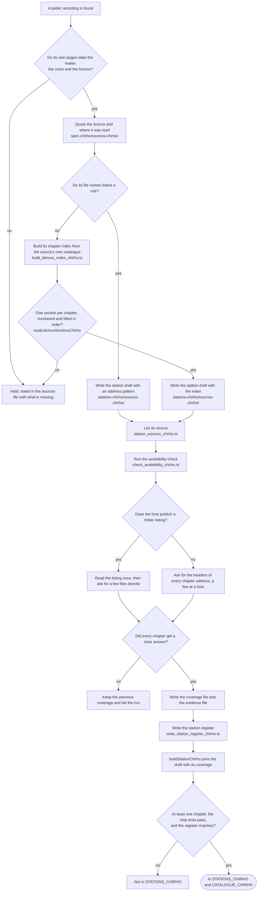
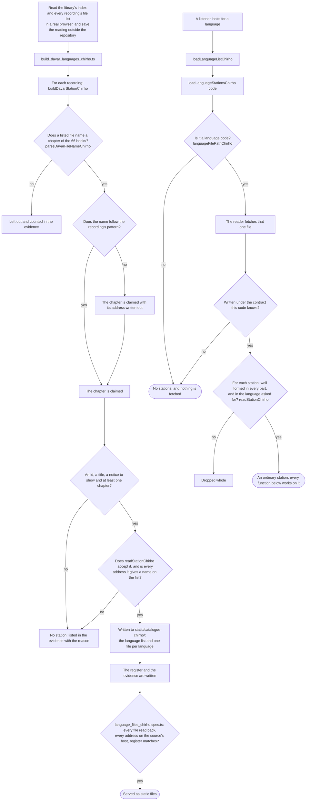
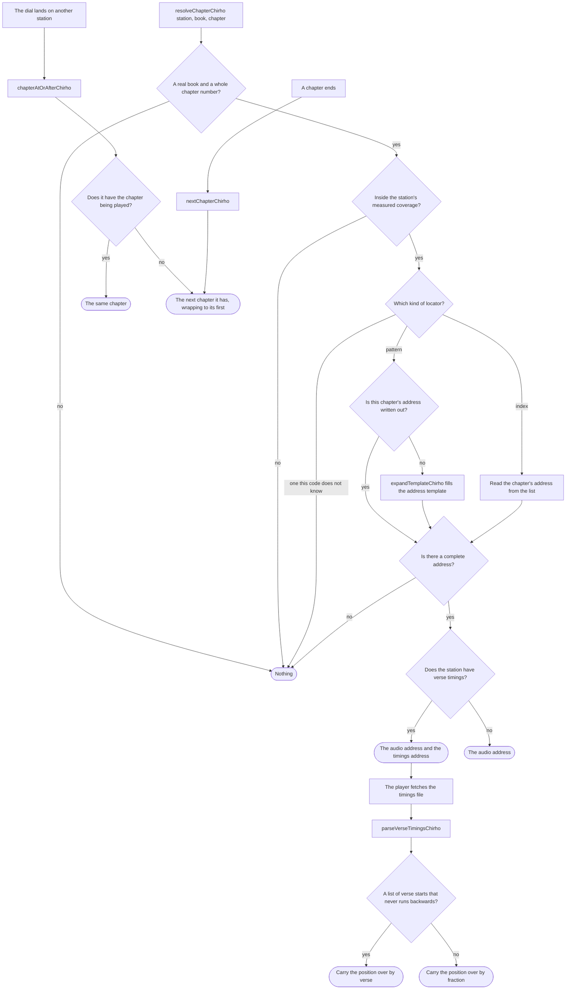
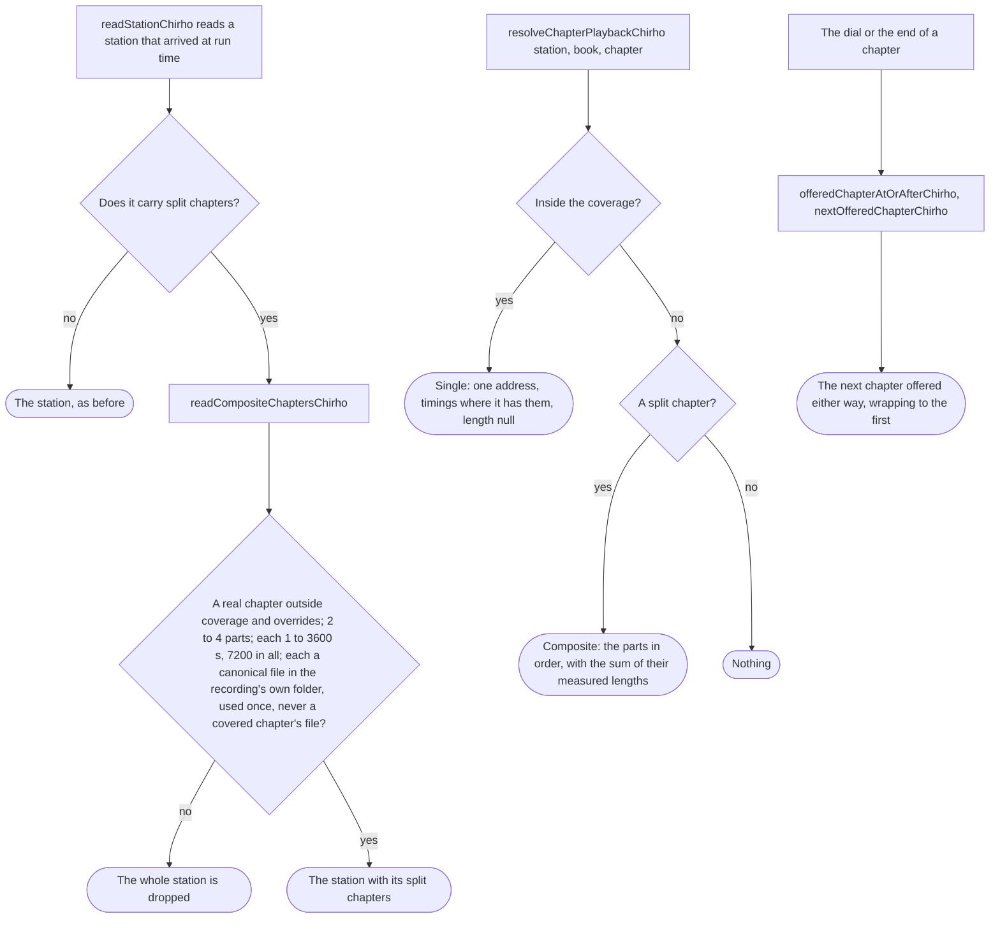

<!-- For God so loved the world, that he gave his only begotten Son, that whosoever believeth in him should not perish, but have everlasting life. — John 3:16 (KJV) -->

# Catalogue workflow

How a recording becomes a station, and how a player finds a chapter on it. The code is in
`src/lib/catalogue-chirho/` and `scripts-chirho/catalogue-chirho/`. Correct this page when the
code proves it wrong.

## A recording becomes a station

A station ships only when two things are true: its licence and credit are on record, and its
chapters were measured at the source. A person supplies the first. Scripts supply the second, and
write the record.

- The check asks each host about the address the catalogue's own resolver gives, so a station
  cannot play from an address that was not the one checked.
- "Absent" needs a clear 404 or 403, asked twice. Anything else is "unverified", and an
  unverified chapter stops the run instead of shrinking the station.
- The coverage files are in `stations-chirho/coverage-chirho/` and the index files in
  `stations-chirho/index-chirho/`, one per source. The evidence files, with counts, sizes and
  what was missing, are in `spec-chirho/evidence-chirho/catalogue-chirho/`.
- The station register, `spec-chirho/sources-chirho/station_register_chirho.md`, lists every
  shipped station's licence, credit and where the licence was read. `register_chirho.spec.ts`
  fails when it differs from what ships.
- A station can be held: defined and measured like the rest, but given to no player. Its source
  lists it under `held_chirho` with the reason, the register prints that reason, and one line
  moves it to `drafts_chirho` when the reason is gone.
- The ship tests are in `catalogue_chirho.spec.ts`. They name no station, so adding one needs no
  change to them.

## A large source becomes stations that load by language

Some sources are too large to send to every listener. Their stations are written as data, one
small file per language, and are fetched only when a listener asks for that language. The rule
is the same: notices on record, chapters measured.

- The files are in `static/catalogue-chirho/`: `languages_chirho.json`, and
  `languages-chirho/<first letter>/<code>.json`. The path is made from the code, never read
  from data.
- `spec-chirho/sources-chirho/davar_station_register_chirho.md` lists every such station with
  its notices. The test fails when it differs from what is served.
- A file that cannot be fetched makes the loader reject, so a player can tell "could not load"
  from "has none".
- The built-in stations do not pass through any of this and are not changed by it.

## A player finds a chapter

Nothing here touches the network. A player can resolve an address and start playing inside the
same tap.

- A timings file can be missing for a single chapter of a station that otherwise has them. The
  evidence file lists those chapters. The player falls back to the fraction.
- A player that meets a locator or timings kind it does not know must skip that station.

## A chapter split across several files

Some recordings split a chapter across files: a Hebrew-count Joel 2, a psalm in two halves. Such a
chapter is carried apart from the coverage, so a player that does not know about it never offers it
and can never play one part as the whole chapter. A player that does know uses the `offered`
helpers and `resolveChapterPlaybackChirho`. No station carries one yet: the parts must first be
measured.

- The older helpers (`resolveChapterChirho`, `stationHasChapterChirho`, `chapterAtOrAfterChirho`,
  `nextChapterChirho`) and `chapter_count_chirho` keep their meaning. They skip a split chapter
  as a chapter the station lacks.
- A measured length proves that the file's metadata could be read. It does not prove that the
  sound is complete, or that it says what the chapter should.
