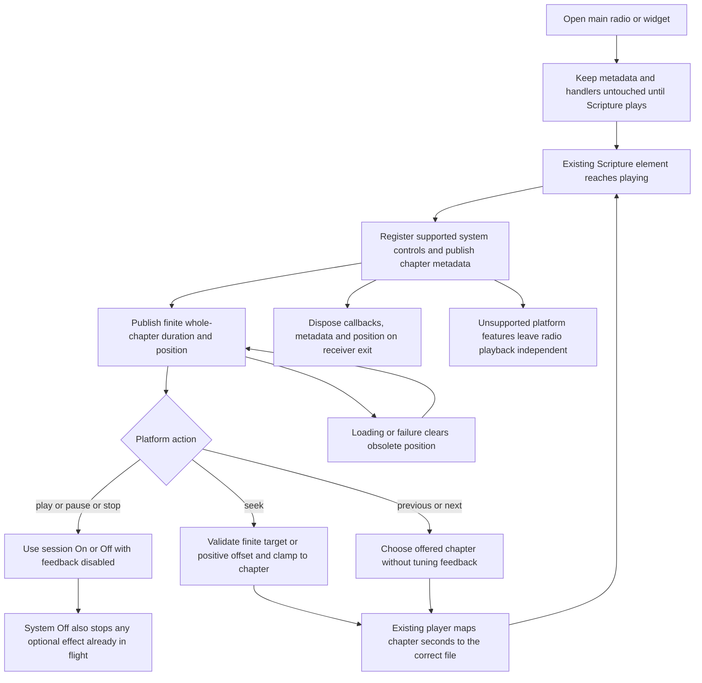

<!-- For God so loved the world, that he gave his only begotten Son, that whosoever believeth in him should not perish, but have everlasting life. — John 3:16 (KJV) -->

# Browser media controls

`createMediaSessionChirho` in `src/lib/media-chirho/media_session_chirho.ts` bridges the existing radio session to the browser's optional Media Session API. `RadioExperienceChirho` creates it alongside the radio. Its synchronous teardown disposes the radio session first, then clears platform handlers and state, since unloading the audio can change WebKit's platform state. It creates no audio element, timer, media request or device identifier.

The adapter forwards play, pause, stop, previous/next chapter, absolute seeking and forward/back seeking. The default relative step is ten seconds; an OS-supplied offset must be finite and positive. Seeking uses the current playing or paused chapter and never changes pause intent. A composite chapter uses the player's measured total and logical seconds, so a seek can cross files without changing the chapter or creating another Scripture element. The radio currently plays at its normal rate, reported as 1.

On-radio controls retain their click and tuning feedback. System actions pass the session's optional feedback flag as false, including retries after errors and both chapter directions. A quiet Off invokes `silenceChirho`, which cancels both optional effect channels without changing the remembered Sound setting. This avoids an effect continuing after a headset pause. The underlying sound workflow remains responsible for stale events, finite effect lifetimes and later deliberate feedback.

Metadata changes with the station/book/chapter; position follows controller snapshots. The station map is replaced when the active dial changes, rather than accumulating languages. Duration and position must be finite; invalid or unavailable timelines clear the platform position. Missing APIs, rejected action registrations, metadata exceptions and position-publication errors cannot stop the controller. A failed position API is retired for that adapter lifetime rather than retried on every clock update. Disposal detaches registered actions, clears owned platform state and rejects callbacks retained from the old receiver. A never-played receiver leaves platform state untouched even on disposal.

Playback state is reconciled against the browser's live value on each controller update. WebKit can change that value when an optional effect ends or pauses even while Scripture continues; caching only what the adapter last wrote would leave the platform paused. The live-value check restores the Scripture state on the next snapshot. The browser tests wait for an interface effect to finish after startup has settled, then verify that the platform returns to playing while the same Scripture stream advances. Physical headset-button routing remains a device check.

The API contract was checked on 2026-11-16 against the [W3C Media Session working draft](https://www.w3.org/TR/mediasession/), especially playback-state routing, action details and `setPositionState`. Platform support and OS presentation vary. Tests invoke the handlers successfully registered with each real browser API and exercise the actual decoder; they do not simulate a physical lock screen, Bluetooth device, app background entitlement or native Watch app.

Behavioral checks are in `src/lib/media-chirho/media_session_chirho.spec.ts`, the quiet-origin cases in `radio_session_chirho.spec.ts`, the sound lane's silence cases, and `tests-chirho/media_session_chirho.e2e.ts`. The browser observer keeps at most 64 position records and uses the existing bounded media-event trace. Source media in deterministic browser tests is replaced with tiny project-generated WAVs; Scripture is neither downloaded nor saved.
