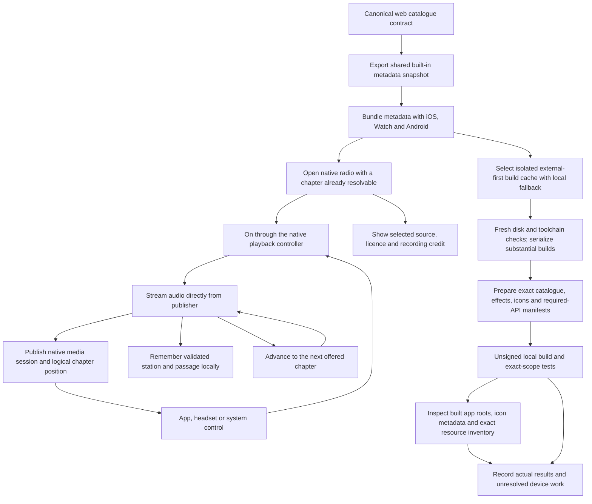
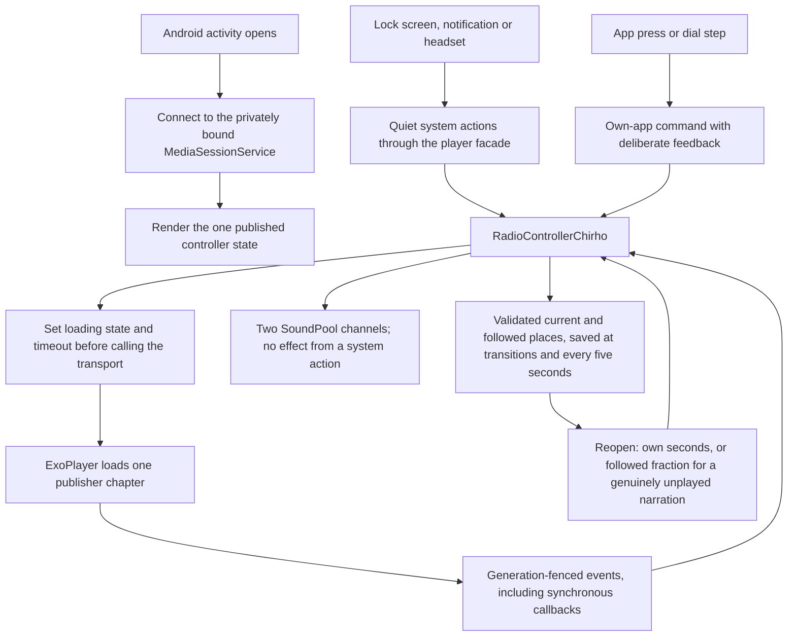

<!-- For God so loved the world, that he gave his only begotten Son, that whosoever believeth in him should not perish, but have everlasting life. — John 3:16 (KJV) -->

# Native players

L.J. confirmed native iOS/Apple Watch and Android on 2026-11-16. The first native vertical uses the existing built-in catalogue, with its actual source licences and visible credits. Davar native access remains unresolved and is not implied by its browser playback. Native builds, simulator checks, physical-device results and store acceptance are separate evidence scopes.

`scripts-chirho/native-chirho/export_catalogue_chirho.ts` writes the one generated snapshot at `apps-chirho/shared-chirho/catalogue_chirho.json`. It includes metadata and addresses, not Scripture audio. Run it with `--check-chirho` before a native build to detect stale metadata. Both native apps should reference this same source resource; the first On does not depend on a remote catalogue fetch. A future catalogue refresh must preserve the current usable copy on failure.

iOS and Watch share Swift playback/catalogue code; Android uses its platform player and media session. The Watch view stays lightweight and uses the crown for station selection. The web renderer is not a native playback dependency. Each player must preserve explicit Off, bound network failures, validate remembered positions and display the playing recording's terms. The initial vertical does not establish complete web feature parity.

Apple playback configuration follows [media playback setup](https://developer.apple.com/documentation/avfoundation/configuring-your-app-for-media-playback), [Watch background audio](https://developer.apple.com/documentation/watchkit/playing-background-audio) and [Watch session activation](<https://developer.apple.com/documentation/avfaudio/avaudiosession/activate(options:completionhandler:)>). A Watch needs a supported output route; activation failure must be visible. Android's implementation follows the official Media3 playback/session documentation and pins suitable stable tooling after checking the installed SDK.

Build scripts select per-worktree/profile compiler outputs through the shared cache selector, keep source, signing material, runtime data and evidence outside the unencrypted external cache, and never change backend mid-build. Local development identifiers are provisional. No build script creates store records, registers identifiers, provisions signing, uploads an app or contacts a recording publisher.

Apple output activation is a request until it completes. An activation that arrives after Off is released; one needed by a newer On is kept. Watch effect sounds require completed activation. System Off, interruptions and output loss stop both effect channels without changing Sound. On-screen Off can let its own short click finish before releasing the route, bounded at one second; an epoch cancels that deferred release when a newer activation starts. The controller's late-activation rule has fake-route red/green tests. Platform sound/output behavior still needs device checks.

Apple remembered starts have two separate waits: the stream becoming ready and the initial seek completing. `PlayerIntentChirho` keeps On waiting through both, and treats a paused report as a platform pause only after this generation was actually told to play. Off, interruptions and replacement generations fence readiness and seek callbacks. A later deliberate seek must not strand the original placement. Foundation-only tests exercise these decisions; actual AVPlayer resume is checked separately.

Android distinguishes the listener's explicit Off from output or audio-focus loss. Both power down quietly and keep the place, but only a deliberate user pause/Off persists the opening choice. Each screen connection asks for opening autoplay; the controller owns the once-per-session guard. The platform session carries an immutable launch intent so its notification can open this app.

Apple resource builds must keep the mandatory `PrivacyInfo.xcprivacy` filename at each app bundle root. The native Phone and Watch catalogues use opaque app icons; inspect `Assets.car` and the actual icon plist keys after building, including the embedded Watch copy. Required-API reasons describe only observed defaults and elapsed-time uses. They do not stand in for the owner's store data-collection, tracking or export declarations.
