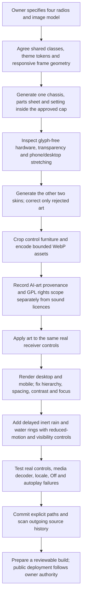

<!-- For God so loved the world, that he gave his only begotten Son, that whosoever believeth in him should not perish, but have everlasting life. — John 3:16 (KJV) -->

# Radio artwork and interaction

One playback controller serves four models. Minimal is drawn in code; Field Radio, 1980s Digital and Cyberpunk use raster chassis frames, control furniture and scenic settings made for this project with GPT Image 2.6 Flare at medium quality. Hardware is artwork; labels, needles, power state and chapter position are live controls. No radio body is an SVG.

`RadioExperienceChirho` owns the remembered model and the About dialog. `RadioReceiverChirho` owns the shared layout; `RadioKnobChirho` supports pointer and keyboard movement plus the caption select. Dragging a knob previews its angle and caption, then commits one passage change on release. A cancelled drag makes no change. The start-to-end arc uses canonical book and chapter position; a single-chapter book has a centred inactive knob and an accessible label.

`ThemeSceneChirho` asks for its low-priority setting after 250 ms. `runRainChirho` caps drops, rings, pixel scale and draw frequency, pauses for a hidden document and clears motion under reduced-motion preference. Its canvas is behind the receiver, hidden from assistive technology and ignores pointer events. Settings are generated scenes, not photographs of real locations. Private prompts, original masters, provider receipts and rejected output remain outside Git; the public licence note names the generation method and the project's rights scope.

The selected art is under `static/images-chirho/radios-chirho/`: five WebP files per raster model. Only selected-theme CSS assets and the delayed scene image are requested; no image decoder or weather loop gates the power handler. Source Scripture continues to use a plain media element and is never packaged with the artwork.
