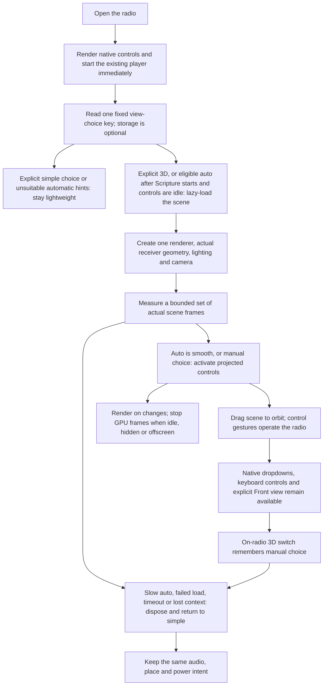

<!-- For God so loved the world, that he gave his only begotten Son, that whosoever believeth in him should not perish, but have everlasting life. — John 3:16 (KJV) -->

# Optional 3D presentation

`RadioSpatialViewChirho` owns presentation lifetime and the optional choice. `createRadioSceneChirho` owns graphics and never receives an audio element or playback controller. The existing `RadioReceiverChirho` stays mounted: `surfaceProjectionChirho` projects its live HTML controls with the same camera as the model. Rotating the camera reveals actual receiver sides and rear. Controls are hidden from the back, with an accessible Front view action; keyboard focus can return the camera to the face. Knob drags use vertical adjustment while angled, preserving accurate value selection. Elsewhere, horizontal touch drag pivots the camera, vertical touch swipes and the mouse wheel scroll the page, and wheel zoom is disabled. Selecting the lightweight view tears down the renderer without remounting playback.

Browser RAM/core values are approximate and sometimes absent. They can rule out an automatic attempt, not establish graphics capacity. The decision uses a bounded sample of the actual scene, respects reduced motion/data saving and a small display, and remembers only `auto`, `simple` or `three`. No fingerprint is stored or transmitted. Manual choice bypasses hints but cannot bypass a renderer failure. Automatic setup waits until Scripture plays and controls have been idle for 1.8 seconds. An automatic switch waits until an active control gesture is finished. An offscreen or hidden warm-up timeout is an interrupted attempt, not a measured slow result. Failed automatic attempts are not retried in a loop.

Model geometry, materials and deterministic textures are locally generated. Shared resources are disposed once; the environment target, light shadow target, renderer, controls, observers, events and animation frame are owned by the scene. Idle scenes draw only in response to changes. First sound never waits for the graphics download or benchmark. The renderer is a separate lazy chunk rather than a dependency of playback or catalogue code.

The web view is suitable for capable touch browsers and future native shells. A native Watch interface uses the lightweight control model and omits 3D code. This architecture is not evidence of native packaging, physical-device audio, lock-screen continuation or store acceptance; those remain separate platform work.
