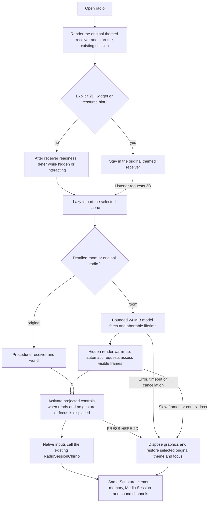

<!-- For God so loved the world, that he gave his only begotten Son, that whosoever believeth in him should not perish, but have everlasting life. — John 3:16 (KJV) -->

# Radio presentation and the listening room

L.J.'s later direction to start in this room on capable machines supersedes the earlier manual-only presentation. The initial HTML and player still load independently of graphics. The optional scene import is scheduled 1.8 seconds after receiver readiness, then deferred for a hidden document, an ongoing pointer gesture or keyboard focus within the receiver. Automatic admission excludes widgets, explicit 2D, reduced motion, data-saving, known slow connections, at most two cores, at most 2 GiB device memory and screens under 300 pixels. Missing optional hints remain unknown. Returning listeners' explicit 2D preference wins. Manual 3D remains available when hints decline automatic entry.

`RadioExperienceChirho` owns the sole Scripture element, `RadioSessionChirho`, sound channels, saved place and platform media bridge. `RadioSpatialViewChirho` owns presentation only. The original `RadioReceiverChirho` stays mounted across view changes. All four original themes (Minimal, 1980s Digital, Field Radio and Cyberpunk) remain available on return to 2D, with the selected theme and passage retained. Widgets keep the original smaller procedural renderer and never auto-load the detailed room.

`createListeningRoomChirho` receives the existing session and snapshots. Its `RoomControlsChirho` adapter owns only projected native DOM inputs, credit and an information dialog; it creates no Audio, storage or Media Session owner. The large knob and station slider call the shared language/narration dial. Book and Chapter labels preview during turning; pointer release commits the choice. Playback-clock snapshots do not reset an active candidate. Power and SFX are buttons. Deliberate dial steps use the existing bounded sound channel; animation and state updates never play an effect.

The detailed GLB is fetched only within that lazy entry, with a 20-second fetch/creation boundary and a streaming 24 MiB size limit even if Content-Length is missing or wrong. Aborted parsing results are disposed when they arrive. A manual request activates after the first successful render; an automatic request samples 30 visible frames, refuses a median over 75 ms or six intervals over 120 ms, and bounds visible warm-up at five seconds. Hidden/offscreen time does not condemn the attempt. No retry loop is started. Failure returns to the themed receiver while Scripture continues.

The room camera has smooth increasing resistance toward horizontal ±18°, up 14° and down 9° from its source angle, and gently returns after release. Editing a projected control holds the camera. Reduced motion disables the automatic return and starts rain/lava still. The room uses bounded instanced rain and animated wax, capped near 24 rendered frames per second. Hidden and offscreen views skip rendering. Horizontal touch gestures orbit; vertical swipes, pinch zoom and the wheel remain available to the browser. Explicit 2D is conspicuous in the toolbar. Manual entry moves focus into that toolbar; leaving restores the original 3D switch. Automatic readiness waits again if the listener focused a receiver control during the download.

Each scene retires its own renderer, context, frame, observers, listeners, environment target and unique model geometry/materials/textures. Replaced glass materials remain tracked for cleanup. Model ImageBitmaps are closed. Disposal is idempotent; tokens and an AbortController fence stale imports, fetches, parsed models and readiness callbacks. A scene chooser retains the earlier procedural radio worlds alongside the detailed room.

The original renderer still projects the mounted receiver with `surfaceProjectionChirho`. Its distinct receiver geometries and procedural worlds stay lazy. Its page-wheel zoom is disabled, control gestures own their input, and Front view, Scene view and distance buttons remain available. Credit and notices occupy bounded receiver slots, so changing text does not resize the hardware.

The runtime GLB belongs under `static/scenes-chirho/listening-room-chirho/`. Editable recipes and original inputs live outside static under `artwork-chirho/listening-room-chirho/`, so they do not enter the web deploy payload. The artwork README and licence record describe provenance and reproduction. The private blend is not a published input because it retains local file-browser references.

Web source/build/browser checks do not establish mobile GPU performance, physical audio, background playback, lock-screen behavior, signing, deployment or store acceptance. Native apps use their own lightweight interfaces and do not bundle this scene.
