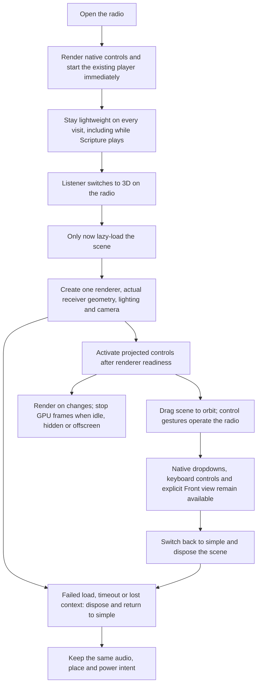

<!-- For God so loved the world, that he gave his only begotten Son, that whosoever believeth in him should not perish, but have everlasting life. — John 3:16 (KJV) -->

# Optional 3D presentation

`RadioSpatialViewChirho` owns presentation lifetime and the optional choice. `createRadioSceneChirho` owns graphics and never receives an audio element or playback controller. The existing `RadioReceiverChirho` stays mounted: `surfaceProjectionChirho` projects its live HTML controls with the same camera as the model. Rotating the camera reveals actual receiver sides and rear. Controls are hidden from the back, with an accessible Front view action; keyboard focus can return the camera to the face. Knob drags use vertical adjustment while angled, preserving accurate value selection. Elsewhere, horizontal touch drag pivots the camera, vertical touch swipes and the mouse wheel scroll the page, and wheel zoom is disabled. Selecting the lightweight view tears down the renderer without remounting playback.

The owner's 2026-11-16 direction supersedes automatic selection and restoring a remembered 3D view. Every visit begins lightweight. No device-hint probe, automatic timer, stored choice or audio event loads the scene. Only the explicit switch starts its dynamic import. Canceling during that import fences the late result so it cannot create a renderer. Renderer failure still returns to simple, without an automatic retry loop or any change to audio. The retired automatic capability/preferences helpers are recoverable from Git history.

Model geometry, materials and deterministic textures are locally generated. Shared resources are disposed once; the environment target, light shadow target, renderer, controls, observers, events and animation frame are owned by the scene. Idle scenes draw only in response to changes. First sound never waits for the graphics download or benchmark. The renderer is a separate lazy chunk rather than a dependency of playback or catalogue code.

The web view is suitable for capable touch browsers and future native shells. A native Watch interface uses the lightweight control model and omits 3D code. This architecture is not evidence of native packaging, physical-device audio, lock-screen continuation or store acceptance; those remain separate platform work.

The wider design target is distinct modeled radio bodies within orbitable environments. The present common receiver geometry and background picture do not complete that target. World meshes, textures and camera controls must stay behind the same explicit activation boundary as this renderer. Browser checks resolve the compiled scene entry from the build manifest and prove it is not requested before the switch, including after audio starts and with legacy saved view values.
