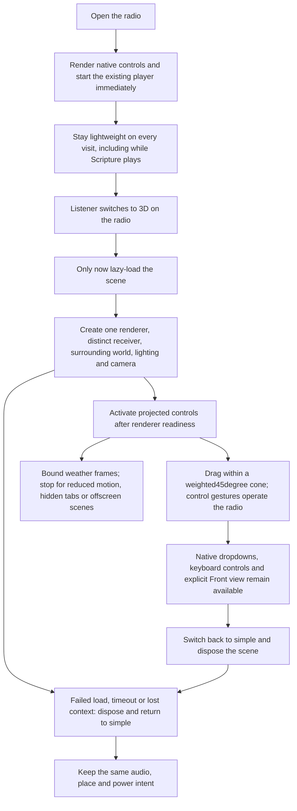

<!-- For God so loved the world, that he gave his only begotten Son, that whosoever believeth in him should not perish, but have everlasting life. — John 3:16 (KJV) -->

# Optional 3D presentation

`RadioSpatialViewChirho` owns presentation lifetime and the optional choice. `createRadioSceneChirho` owns graphics and never receives an audio element or playback controller. The existing `RadioReceiverChirho` stays mounted: `surfaceProjectionChirho` projects its live HTML controls with the same camera as the model. The camera reveals the actual receiver sides within a 45-degree cone around its source angle. Resistance increases toward the edge; after release, an idle camera gently returns toward that angle. Pointer/control interaction holds the view steady, and reduced motion disables the automatic return. Front view clears momentum and brings controls near. Knob drags use vertical adjustment while angled, preserving accurate value selection. Elsewhere, horizontal touch drag pivots the camera, vertical touch swipes and the mouse wheel scroll the page, and wheel zoom is disabled. Selecting the lightweight view tears down the renderer without remounting playback.

The owner's 2026-11-16 direction supersedes automatic selection and restoring a remembered 3D view. Every visit begins lightweight. No device-hint probe, automatic timer, stored choice or audio event loads the scene. Only the explicit switch starts its dynamic import. Canceling during that import fences the late result so it cannot create a renderer. Renderer failure still returns to simple, without an automatic retry loop or any change to audio. The retired automatic capability/preferences helpers are recoverable from Git history.

Model geometry, materials and deterministic textures are locally generated. Shared resources are disposed once; the environment target, light shadow target, renderer, controls, observers, events and animation frame are owned by the scene. The minimal studio draws in response to changes and during a pending camera return. Other worlds animate bounded water vertices and rain near 30 frames per second; reduced motion makes them still. Hidden or offscreen scenes stop their frame requests. First sound never waits for the graphics download or benchmark. The renderer is a separate lazy chunk rather than a dependency of playback or catalogue code.

The web view is suitable for capable touch browsers and future native shells. A native Watch interface uses the lightweight control model and omits 3D code. This architecture is not evidence of native packaging, physical-device audio, lock-screen continuation or store acceptance; those remain separate platform work.

Each model now has a physical silhouette: a minimal receiver, deep field cage, wide stereo portable or beveled cyberpunk equipment case. Its actual surroundings contain ground, water, rocks/foliage or city meshes, rather than a background picture alone. World resources live under `world-chirho/`; chassis construction lives beside the receiver under `model-chirho/`. One active world owns its meshes, instanced geometry, materials and procedural textures and retires each once. The former image/weather backdrop is unmounted while the world is active. These modules remain behind the same explicit activation boundary as the renderer. Browser checks resolve the compiled scene entry from the build manifest and prove it is not requested before the switch, including after audio starts and with legacy saved view values.

The explicitly requested scene becomes ready after its first successful render. The retired automatic frame-rate assessment is not a prerequisite for a manual view. One material palette belongs to the scene for the current theme; layout changes replace geometry while retaining that palette and its GPU programs. A theme change or scene disposal retires it exactly once. Standalone model callers still own their default palette. The resource test exercises both ownership paths.

The camera stage and camera toolbar occupy separate rows. The stage owns clipping and is the renderer/projection viewport, so a phone toolbar cannot cover the recording credit. Explicit zero-minimum grid tracks constrain both the outer page and the stage to the frame width. Tall scenery sits outside the supported viewing cone; low foreground detail still produces parallax without blanking the receiver. Front view clears momentum and brings controls near, Scene view frames the whole body, and explicit distance buttons avoid capturing page-wheel scrolling. Phone entry starts near its controls.

Receiver text has bounded slots. Publisher credit remains inside a fixed, scrollable region, and loading/error/restore/storage messages occupy a reserved notice region. These contents can change without rebuilding a taller chassis or moving its controls. Longer dropdown values remain single-line native selects. The About dialog receives its explicit opening element and restores focus on close, including in WebKit.

The owner subsequently selected a more detailed Christian 1980s listening room as the visual priority. The procedural worlds are a working development stage, not acceptance of that new art target. The new image reference and isolated Blender candidate stay private while visually reviewed; neither is substituted for a working 3D room. Paid image-to-3D conversion requires its separately stated pilot scope. A completed candidate must retain the same explicit scene-load boundary and existing audio controller.
