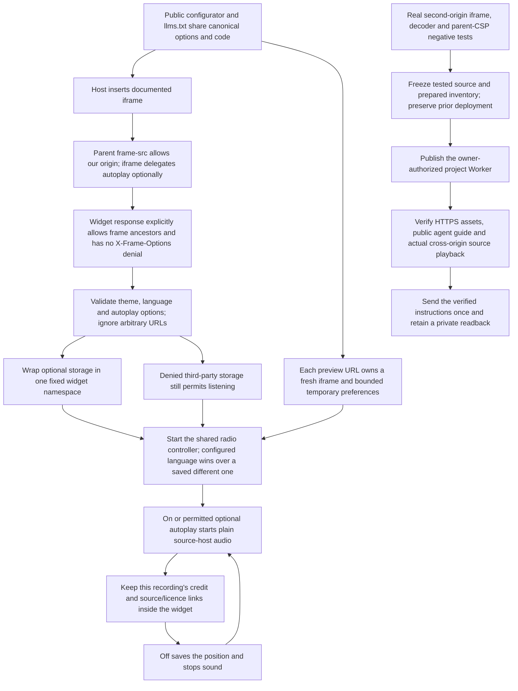

<!-- For God so loved the world, that he gave his only begotten Son, that whosoever believeth in him should not perish, but have everlasting life. — John 3:16 (KJV) -->

# Outside-site widget and publication

The owner's instruction authorizes the radio update and an externally embeddable widget, AI-agent instructions and one post-verification delivery through the existing messaging app. The recipient, message body and delivery record remain private.

`readWidgetOptionsChirho`, `widgetStorageChirho` and `RadioExperienceChirho` provide the widget boundary. It uses the existing catalogue and player; no station object, media URL or callback is accepted from the embedding page. Defaults are no automatic sound, optional local preferences and no tuning sound on a first run. A listener can enable sounds. Only four fixed preference keys receive the widget prefix, so there is no per-host or per-instance storage growth. The complete recording credit remains in the receiver. Widget artwork is framed in our document; no style, weather canvas or image path is injected into the host page.

`hooks.server.ts` changes framing headers only for the dedicated widget route. Worker/SSR responses must carry those headers themselves; a static-assets _headers file does not affect them. Existing routes and private-file handling are unchanged. `/llms.txt` is a plain UTF-8 response with public CORS for agent readers. Iframe navigation does not require CORS. The agent guide describes parent frame-src versus child frame-ancestors, optional autoplay delegation, sandbox compatibility, free access and each recording's terms. Davar remains non-commercial only. Audio is streamed, never mirrored or bundled.

The browser test host is a real HTTP server on a separately allocated loopback port. A route-intercepted fake host initially failed Chromium's Local Network Access checks when it tried to reach loopback; it was replaced with actual HTTP transport, without disabling that browser protection. A parent CSP denial remains a deliberate failing control, distinct from our allowed response. Production verification uses an HTTPS parent origin and the real public widget, without substituting media.

Only the configured Worker is deployed. The private preflight retains active version ids, exact deployment responses and a verified copy of the prior package. The hosted asset verifier's `--widget-chirho` option writes a separate release record rather than overwriting the first publication's evidence. No DNS change, provider signup or new service account is part of this release.

The configurator adds `preview_chirho=1` only to its own preview URL, never to the copied iframe. `createPreviewStorageChirho` keeps at most eight temporary keys in the current preview; it does not read or replace saved widget preferences. Spatial choices are temporary there too. A keyed preview frame prevents an older queued lazy navigation from replacing a newer model/language selection. Selecting the browser-language default therefore previews a fresh visitor. Normal embeds retain their fixed persistent namespace.
