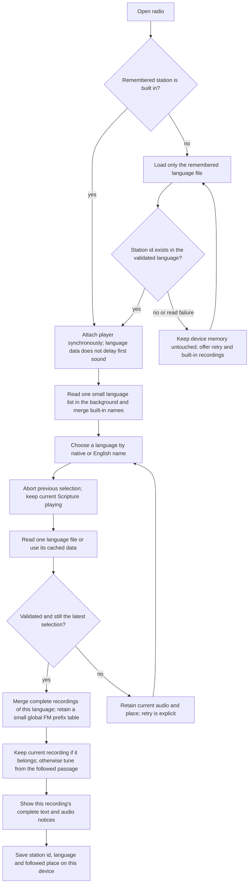

<!-- For God so loved the world, that he gave his only begotten Son, that whosoever believeth in him should not perish, but have everlasting life. — John 3:16 (KJV) -->

# Choosing and restoring a language

`RadioSessionChirho` owns startup and the active language, `LanguageLibraryChirho` owns bounded catalogue reads, and the player accepts complete ordinary stations through `setStationsChirho`. Source validation stays in the catalogue module. Device storage contains bounded ids, language codes and reading position; never a station object, address or licence.

The client allows one index request and one selected-language request, each capped at 128,000 bytes while streaming and eight seconds including the body. The index is kept once; at most three language files remain cached. A newer selection aborts the previous one, rejects late results before caching, and checks a request number before changing the screen. Choosing a recording directly or returning to the built-in dial also cancels a pending selection. Closing the screen aborts both requests. No audio is fetched by this client.

The index is optional for opening a remembered station. A missing (404) language file falls back to built-in recordings of that language, since some languages exist only in the bundled catalogue. Network failures and other HTTP errors remain failures. When a dynamic station cannot restore, no player is constructed and pagehide writes nothing; retry, language selection and direct built-in selection remain usable. A successful restore follows the saved power choice and the browser autoplay policy. Built-in station restores remain immediate even while additional stations in the selected language load.

The integrated label dropdowns and FM dial combine 29 built-in recordings and 431 Davar recordings: 460 stations across 400 distinct language tags. Built-in coverage was measured chapter by chapter. Davar coverage is matched to the publisher's own file lists; the catalogue seat opened only the first listed audio file of each recording. The screen describes these chapters as publisher-listed. Both text and audio notices stay visible below the selected recording, and English fallback names use English pronunciation tags.

Behavioral tests cover deferred loading, merging, cancellation, cache eviction, oversized bodies, timeout, failed reads and retry, dynamic preference validation, source-host resolution, language-scoped tuning, repeated restore failures, an interrupted restoration, direct fallback and 320 px layout. Generated WAV fixtures prove browser integration without copying Scripture; real-source observations are recorded separately.

## First-run language and direct tuning

When a valid station is remembered, it wins over browser preferences. Otherwise the first browser language is matched against available tags, including parent tags such as es-MX to es. English attaches immediately without waiting for the language index. Other first-run languages get a 1.5-second lookup budget; failure falls back to an available bundled language or English. Late startup responses cannot replace a newer listener selection. No IP address lookup is used.

Translation defaults prefer established editions already in this cleared catalogue; this is not a claim of theological unanimity. Within that version, a narrator documented as male receives the owner's requested initial preference. Bob Souer's own description at https://bobsouer.com/blog/ supports that one current preference. Other genders are not inferred from names, and all available narrations remain in the voice dropdown.

The language and version labels are native selects. Each moves the FM marker to that language and recording. A prefix table holds counts and offsets for the 400 language tags; a binary search maps a released dial position to a language and ordinal. Only its selected language is loaded. Dragging previews the marker without requesting each intermediate station. Knob drags likewise commit once on release, with keyboard and label-select alternatives. Failed language changes restore the label to the station still playing, so the same language can be chosen again to retry.
