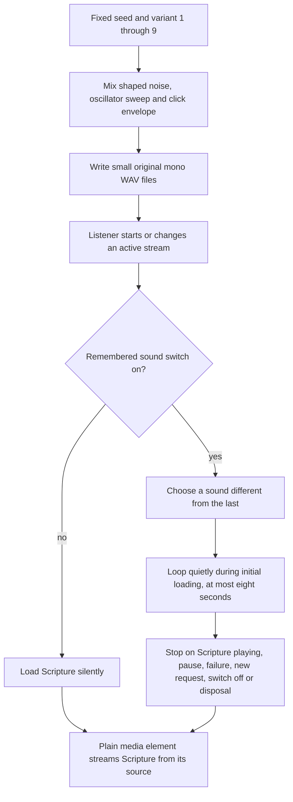

<!-- For God so loved the world, that he gave his only begotten Son, that whosoever believeth in him should not perish, but have everlasting life. — John 3:16 (KJV) -->

# Original radio sounds

The generator `scripts-chirho/generate_radio_sounds_chirho.ts` emits nine deterministic PCM WAV files, 22,050 Hz mono. Their combined size is 202,812 bytes. No external audio is used. Reproduce with `bun scripts-chirho/generate_radio_sounds_chirho.ts`; verify checked-in bytes with `--check`.

`createRadioSoundsChirho` handles effects only. Scripture never enters an AudioContext; cross-origin source audio has no CORS header and would become silent if routed through Web Audio. A rejected optional sound play promise cannot stop Scripture.

The intended gain (0.18) is encoded into the WAV samples. Every file is verified below 0.16 full-scale peak, independent of element volume. This follows [Apple's documented iOS volume behavior](https://developer.apple.com/library/archive/documentation/AudioVideo/Conceptual/Using_HTML5_Audio_Video/Device-SpecificConsiderations/Device-SpecificConsiderations.html); physical device levels are still to be checked.
