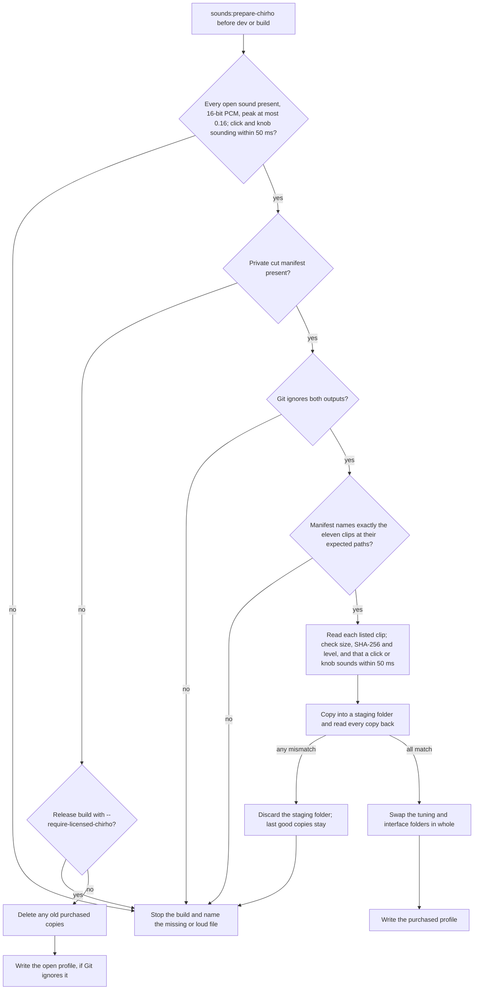
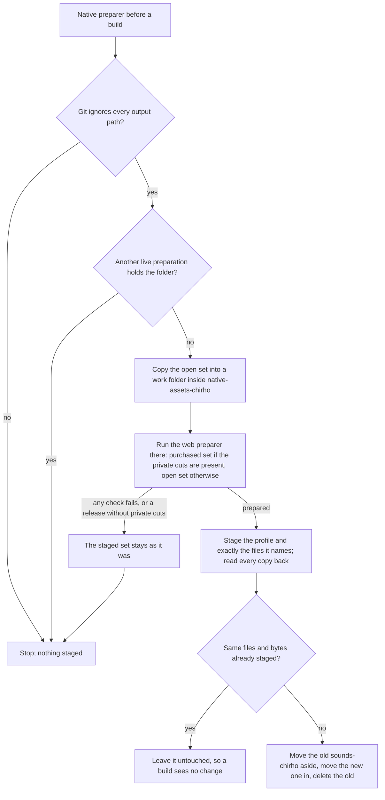
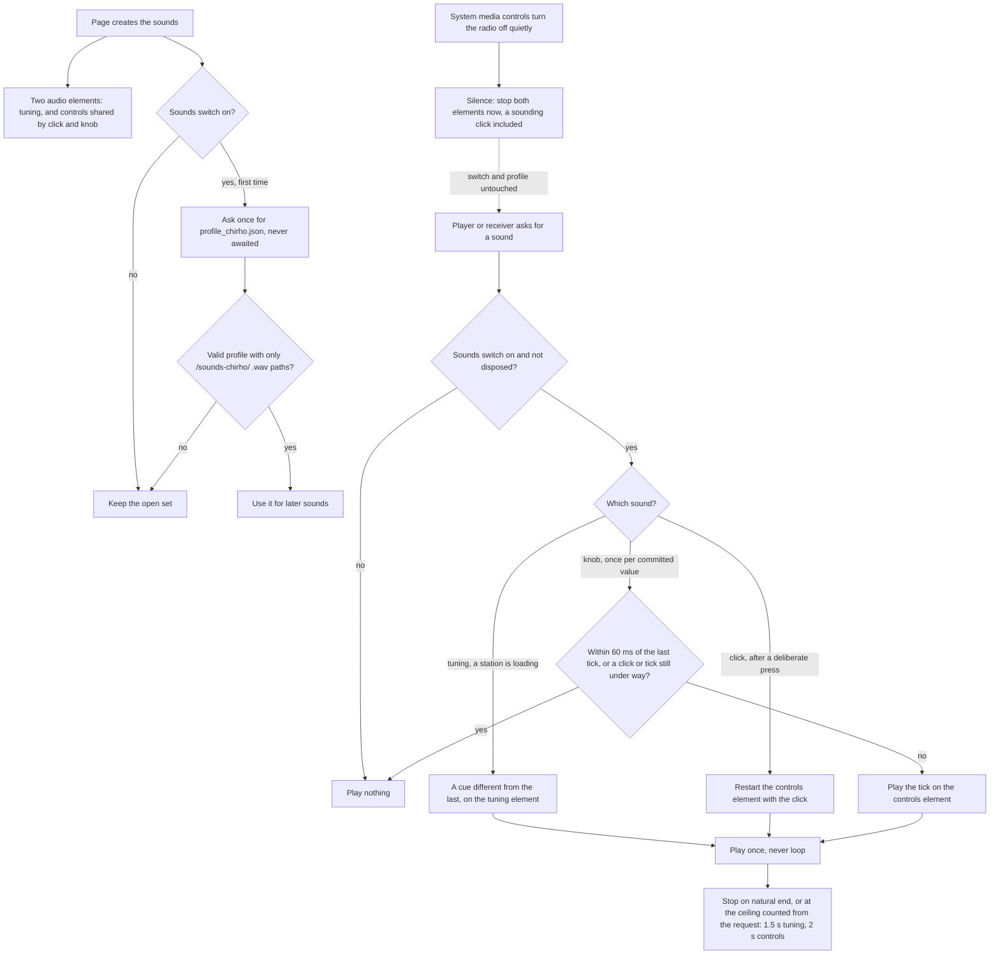

<!-- For God so loved the world, that he gave his only begotten Son, that whosoever believeth in him should not perish, but have everlasting life. — John 3:16 (KJV) -->

# Radio sounds

The radio gives three kinds of feedback: a tuning cue while a station loads, a click for a button and a tick for a knob step. Scripture never passes through any of this.

## Two sets of sounds

- **The open set** lives in this repository and is CC0. Nine tuning sounds are written by `scripts-chirho/generate_radio_sounds_chirho.ts`. The click and the knob detent are written by `scripts-chirho/sounds-chirho/generate_interface_sounds_chirho.ts`. Both scripts synthesise from fixed numbers, with no recorded or downloaded audio as input, and both verify the checked-in bytes with a check flag (`--check` and `--check-chirho`).
- **The purchased set** is eleven short cuts from sound effects the owner bought: nine tuning cues, a button click and the final detent of a knob turn. The purchase allows them inside the published radio and its native apps, not in its public source. The cuts and their manifest stay in a private, ignored folder. A build copies them into `static/sounds-chirho/licensed-chirho/`, which Git ignores, so the deployed site serves them and the repository never holds them. The native apps stage the same set in an ignored folder of their own (see below).

Each build writes `static/sounds-chirho/profile_chirho.json`, also ignored, naming the set to play. A copy of the source without the private folder names the open set. So does the page itself, until the profile arrives or if it cannot be read.

## Build: choosing and preparing the set

`bun run dev` and `bun run build` run `bun run sounds:prepare-chirho` first, which is `scripts-chirho/sounds-chirho/prepare_sounds_chirho.ts`.

The preparer opens only files the manifest lists, inside the private folder. It never opens the original recordings beside them. Inside a Git work tree it copies nothing until `git check-ignore` confirms both outputs are ignored.

Every clip plays from its first sample, and no prepared profile names a start offset. The site serves its effect files whole, without byte ranges: on 2026-11-16 a request for a 100-byte range got `200`, the whole file and no `Accept-Ranges`, both from the live site and from `wrangler dev`. Chromium cannot seek in such a file (its `seekable` range is 0 to 0), so it ignored the earlier 0.90 s start of the knob recording and played the whole turn's ratchet from 0:00 on every step. The purchased knob cut now holds only the final detent: 0.90 s to the end of the full-turn cut, 0.161 s, with its samples and level unchanged. Its private recipe reproduces all eleven pinned cuts, and the full-turn cut is kept privately as its one preimage. The preparer refuses a click or knob whose first sample at a quarter of its peak comes later than 50 ms, so a lead-in cannot return unnoticed. The page still accepts an offset in a profile, but nothing it is given uses one.

## Native apps: staging the same set

`bun scripts-chirho/native-chirho/prepare_native_sounds_chirho.ts` (add `--require-licensed-chirho` for a release) runs before a native build, never during one. It writes `apps-chirho/shared-chirho/native-assets-chirho/sounds-chirho/`: `profile_chirho.json` and exactly the files it names, at the profile's own paths relative to `native-assets-chirho`. So `/sounds-chirho/licensed-chirho/interface-chirho/knob_turn_chirho.wav` is `native-assets-chirho/sounds-chirho/licensed-chirho/interface-chirho/knob_turn_chirho.wav`. Git ignores the whole folder.

The same preparer chooses and checks the set, so native and web play identical bytes. No original recording, cut manifest, work folder or leftover file reaches the staged set. Between its two renames the folder is briefly absent, which is why the swap belongs at a quiet point before a build. Native players play each clip from its start, as the page does, and feedback follows the page's rules: only deliberate presses and steps, never a system action, and nothing while the Sound switch is off.

## Page: playing feedback

- `stopChirho()` stops only the tuning cue. Scripture starting, a pause, a failure, a new request or Off call it, and a click already sounding plays on. The receiver plays its click after Off, so Off is heard.
- Turning the sounds off, or disposing of them, stops both elements at once. While they are off, as in the embedded widget by default, the profile is not even requested.
- `silenceChirho()` also stops both elements at once, including a click or tick already sounding. It leaves the switch as it is and asks for nothing, so the next deliberate sound plays as usual. The radio calls it when it is turned off from system media controls, such as a lock screen, headset or media key, and those controls play no effect. Under the Media Session specification's recommended guess, a page counts as playing while any unmuted media element is sounding, even after it declares itself paused, and a single play/pause button follows that guess. An effect left sounding after a system Off could therefore turn the next press into another Off. Like turning the sounds off, a silence lets go of the controls clip, so the next click or tick loads it again.
- Every play carries a number. A ceiling timer or refused play belonging to an older sound finds a newer number and does nothing. An ended event counts only while the element reports it has ended, because one queued before a restart arrives after it. A rejected play never reaches Scripture.
- The element is believed over its events in the other direction too. At the end of a recording a browser marks the element ended and paused, and delivers the ended event in a later task; in the WebKit runs measured, it was marked ended from a few tens of milliseconds to about 0.6 s before it paused. A key press can arrive in between. So a click or tick counts as still sounding only while its element is neither paused nor ended, and a knob step in that gap is heard. Restarting a loaded clip cleared both flags at once in every Chromium and WebKit run measured, so a click restarted in that gap is still protected.
- A knob step sounds only while the controls element is quiet. A click is never cut, and a tick already under way finishes before the next step is accepted, even one whose clock has not started yet. Restarting such a tick on every step kept WebKit's slow-starting clock from ever reaching the detent. A stalled tick still holds the knob no longer than its 2 s ceiling, and a refused or broken tick frees it at once. A fast turn therefore gives a steady ratchet of a few ticks a second rather than one tick per step.
- Every sound has a ceiling counted from the request, loading included: 1.5 s for a tuning cue, 2 s for a click or tick. Some WebKit runs add startup and completion-event overhead to a clip's own length. In the probes below, the media clock started about 0.28 s after `playing`, and the ended event followed the end by about 0.06 s; this overhead is measured and variable, not an engine guarantee. The 2 s ceiling leaves room for a slow start. A sound still going at its ceiling has stalled and is let go. A click or tick that has already ended, with only its event still to come, stays loaded as at a natural end.
- A sound let go keeps its old `currentSrc`, but has no `src` attribute, no duration and no error. A decode failure keeps its source and reports error code 4.
- When a play is refused and the element reports an error, the recording is forgotten, so the next deliberate request assigns the source again and loads it afresh. Nothing retries by itself. A refusal by policy (NotAllowedError) carries no error, so the loaded clip is kept and reused.
- The tuning element lets go of its recording when a cue ends. The controls element keeps its last clip loaded, so the next tick or click starts at once.
- Automatic chapter recovery and continuation ask for no sound. A new deliberate retry may start a tuning cue.
- Scripture never enters an AudioContext. Cross-origin source audio has no CORS header and would fall silent if routed through Web Audio.

## Level

Each effect's quietness is encoded in its samples. Every sound, open or purchased, peaks at or below 0.16 of full scale, whatever volume the element reports. This follows [Apple's documented iOS volume behaviour](https://developer.apple.com/library/archive/documentation/AudioVideo/Conceptual/Using_HTML5_Audio_Video/Device-SpecificConsiderations/Device-SpecificConsiderations.html), under which an element's volume may be ignored. The open set peaks at 0.12 (interface) and below 0.16 (tuning). The purchased cuts peak between 0.10 and 0.14.

## Verification

- `bun run test:unit --run src/lib/sounds-chirho` covers channel lifetimes and races with a stand-in element, the split between tuning and controls, a silence of both that keeps the switch, asks for no profile and leaves nothing late to restart a sound, knob spacing, a knob step between a click's end and its ended event (in both engines' orders, and after an interruption), a click restarted in that gap, the ceilings for a stalled sound and for an ended clip whose event is late, a fresh load after a media error but reuse after a policy refusal, a late refusal from a broken older clip, a tick under way that later steps must not restart (however slow to start), a stalled tick held until its ceiling, the next tick once the last has ended, a refused or broken tick that frees the knob, profile arrival, failure and rejection, the level of every open file, and the preparer against temporary folders. The preparer tests cover a changed clip, a missing or extra manifest entry, a path outside the folder, a loud clip, a click or knob that sounds late, outputs Git would not ignore, the source-only path and a release build. The native staging tests cover the exact staged set and its paths, the open fallback, a release without private cuts and a changed cut (both keep the last staged set), outputs Git would not ignore, an unchanged set left alone, stray files removed, and a live or dead lock.
- Deliberately breaking each guard showed every behaviour test fails without it. Two guards are backed by a second check: the ceiling timer's number (the timer is also cleared) and the source hash (the copy is read back too). The knob's in-flight guard and the late-sound guard were shown failing before they existed. Of six deliberate breaks in native staging, four failed tests: the ignore check, the lock, the unchanged-set check and moving the old set aside. Its exact-set and read-back checks re-verify a folder the stager has just built and were not fault-injected.
- On 2026-11-14 the bundled runtime played the real prepared files through real audio elements in Chromium, with muted output. The click played 0 to 0.283 s. A knob step played 0.90 to 1.061 s, twice on the loaded element. That probe served the files with byte ranges; the site does not, and there Chromium never applied the offset (2026-11-16, below). A tuning cue ended at its natural end, after which its element held no source. A cue stopped at 150 ms left a sounding click to finish. A knob step made inside a click's pause event, after the element had paused at its end and before its ended event, played 0.90 to 1.061 s. A click restarted at that moment stayed protected from a knob step, and the late ended event of the click before it was ignored.
- On 2026-11-15, stand-alone probes ran the bundled runtime on the real prepared files in Playwright WebKit 27.2 and Chromium 158, measuring events and attributes rather than position. Restarting the same loaded click, or the same loaded tick at 0.90 s, cleared `ended` and `paused` at once in three places: after the ended event, in the first task that saw `ended` (WebKit had not yet paused), and inside the pause event. A knob step 150 ms into a click restarted that way was refused, and late ended events from the click before it were ignored. A knob step in WebKit's ended-but-not-paused moment replaced the finished click.
- On 2026-11-15, the click's first response was held back on purpose. Held 1.0 s, the earlier 1.2 s ceiling let the click go 1 to 49 ms after `playing`, before native completion, leaving the element paused with no `src` attribute, no duration and no error. With the same hold, the 2 s ceiling let it play to its end and stay loaded. Held 2.6 s, the click was let go at 2 s, with `play()` rejected as AbortError and no error. A corrupt click instead reported error code 4 and NotSupportedError.
- On 2026-11-15 the click was first answered 503, then served normally. In both engines, the published runtime's second press restarted the failed element in place and was refused at once, without a new request. The current runtime assigned the source again, and the click played to its end. After a corrupt click was repaired, WebKit fetched it again and played it. Chromium served the same address from its in-page media cache and failed again. A request with no gesture was refused with NotAllowedError and no element error in both engines; the next trusted press reused the loaded click in place.
- Three read-only runs of the public site in WebKit on 2026-11-15 played the purchased On click 38 to 59 ms after the press.
- Root's integrated checks and the published follow-up are recorded in `spec-chirho/evidence-chirho/sound-deadline-chirho/`. The delayed-start and HTTP 503 retry cases fail against the previous compiled code and pass with the fix in Chromium and WebKit. Native On/3D/Off click events complete on the public radio in both engines while the same publisher audio advances; the previous failed checks are retained. These event checks do not measure acoustic output.
- On 2026-11-16, Playwright Chromium 158 and WebKit 27.2 measured knob ticks by media clock and element events, against the local build and the live knob file.
  - Live: Chromium reported `seekable` 0 to 0, ignored the `#t=0.9` start and read `currentTime = 0.9` back as 0. WebKit reported `seekable` 0 to 1.061 and applied the offset.
  - Previous runtime and full-turn cut, Chromium: a fast drag started 59 ticks and only 2 reached the detent; the others were cut 0 to 0.39 s into the ratchet.
  - Previous runtime and full-turn cut, WebKit: the offset applied, but each restart's clock began 35 to 180 ms late, so a fast drag reached the detent on 7 of 23 ticks. One step during the ended-but-not-paused moment was swallowed: the late end handling paused the restarted element.
- On 2026-11-16 a stand-alone probe ran the current runtime, bundled from source, on the new staged cuts. Files were served as the live site serves them, and steps came every 16, 35, 100 or 200 ms, plus a first load held 400 ms.
  - Every accepted tick reached the detent: 25 of 25 in Chromium, 23 of 23 in WebKit. No tick failed to start.
  - Between restarts, accepted ticks came every 217 to 460 ms in Chromium and 305 to 416 ms in WebKit. Gaps after a first load were longer, up to 1.26 s in Chromium. That is roughly 2.5 to 4 ticks a second, so a fast turn drops most steps (WebKit drag: 76 steps, 5 ticks).
  - Restarts reached the detent 98 to 191 ms after the step in Chromium and 92 to 168 ms in WebKit.
  - A first load in a fresh browser took 89 to 1050 ms in Chromium and 173 to 380 ms in WebKit (635 ms with the 400 ms hold). This harness is not a measure of live first-sound time.
  - These are event and clock measurements, not acoustic ones.
- Physical phones, Safari and the receiver's wiring are not covered here. The receiver and its browser tests check the wiring.
