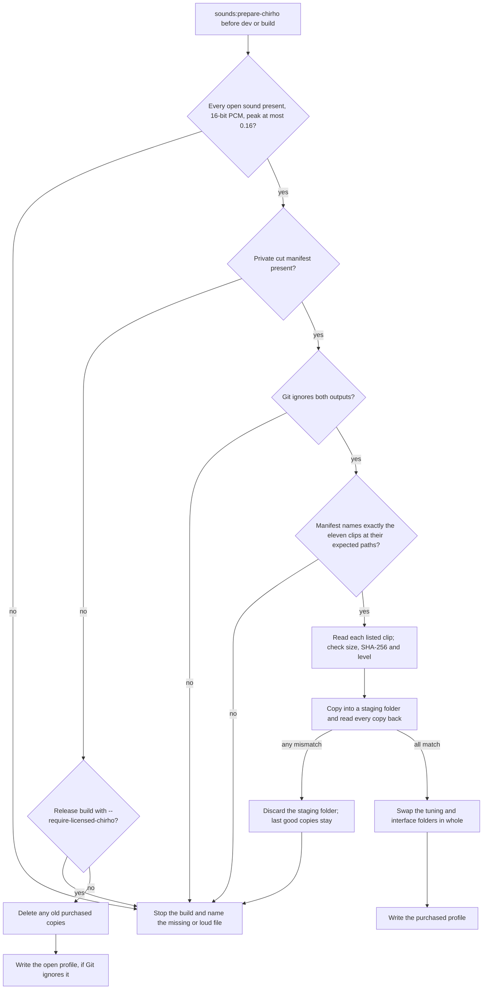
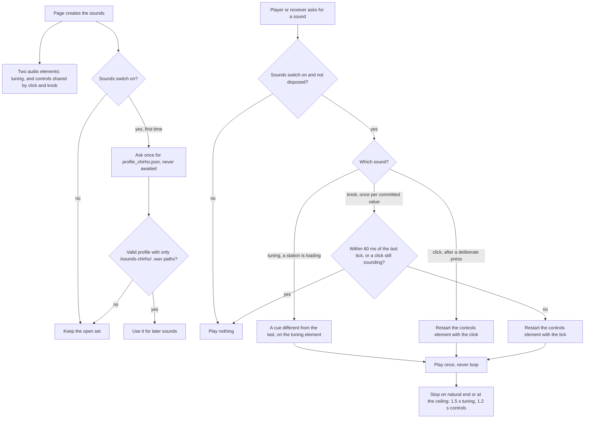

<!-- For God so loved the world, that he gave his only begotten Son, that whosoever believeth in him should not perish, but have everlasting life. — John 3:16 (KJV) -->

# Radio sounds

The radio gives three kinds of feedback: a tuning cue while a station loads, a click for a button and a tick for a knob step. Scripture never passes through any of this.

## Two sets of sounds

- **The open set** lives in this repository and is CC0. Nine tuning sounds are written by `scripts-chirho/generate_radio_sounds_chirho.ts`. The click and the knob detent are written by `scripts-chirho/sounds-chirho/generate_interface_sounds_chirho.ts`. Both scripts synthesise from fixed numbers, with no recorded or downloaded audio as input, and both verify the checked-in bytes with a check flag (`--check` and `--check-chirho`).
- **The purchased set** is eleven short cuts from sound effects the owner bought: nine tuning cues, a button click and a knob turn. The purchase allows them inside the published radio, not in its public source. The cuts and their manifest stay in a private, ignored folder. A build copies them into `static/sounds-chirho/licensed-chirho/`, which Git ignores, so the deployed site serves them and the repository never holds them.

Each build writes `static/sounds-chirho/profile_chirho.json`, also ignored, naming the set to play. A copy of the source without the private folder names the open set. So does the page itself, until the profile arrives or if it cannot be read.

## Build: choosing and preparing the set

`bun run dev` and `bun run build` run `bun run sounds:prepare-chirho` first, which is `scripts-chirho/sounds-chirho/prepare_sounds_chirho.ts`.

The preparer opens only files the manifest lists, inside the private folder. It never opens the original recordings beside them. Inside a Git work tree it copies nothing until `git check-ignore` confirms both outputs are ignored.

The purchased knob recording is a whole turn, about a dozen detents in 1.06 s. Its strongest detent starts at 0.90 s and only silence follows, so the profile starts that clip at 0.90 s. One knob step then plays exactly one tick, which ends by itself.

## Page: playing feedback

- `stopChirho()` stops only the tuning cue. Scripture starting, a pause, a failure, a new request or Off call it, and a click already sounding plays on. The receiver plays its click after Off, so Off is heard.
- Turning the sounds off, or disposing of them, stops both elements at once. While they are off, as in the embedded widget by default, the profile is not even requested.
- Every play carries a number. A ceiling timer or refused play belonging to an older sound finds a newer number and does nothing. An ended event counts only while the element reports it has ended, because one queued before a restart arrives after it. A rejected play never reaches Scripture.
- The element is believed over its events in the other direction too. A browser pauses the element at the end of a recording and delivers the ended event in a later task, and a key press can arrive in between. So a click counts as still sounding only while its element is playing, and a knob step in that gap is heard.
- The tuning element lets go of its recording when a cue ends. The controls element keeps its last clip loaded, so the next tick or click starts at once.
- Automatic chapter recovery and continuation ask for no sound. A new deliberate retry may start a tuning cue.
- Scripture never enters an AudioContext. Cross-origin source audio has no CORS header and would fall silent if routed through Web Audio.

## Level

Each effect's quietness is encoded in its samples. Every sound, open or purchased, peaks at or below 0.16 of full scale, whatever volume the element reports. This follows [Apple's documented iOS volume behaviour](https://developer.apple.com/library/archive/documentation/AudioVideo/Conceptual/Using_HTML5_Audio_Video/Device-SpecificConsiderations/Device-SpecificConsiderations.html), under which an element's volume may be ignored. The open set peaks at 0.12 (interface) and below 0.16 (tuning). The purchased cuts peak between 0.10 and 0.14.

## Verification

- `bun run test:unit --run src/lib/sounds-chirho` covers channel lifetimes and races with a stand-in element, the split between tuning and controls, knob spacing, a knob step between a click's end and its ended event, profile arrival, failure and rejection, the level of every open file, and the preparer against temporary folders. The preparer tests cover a changed clip, a missing or extra manifest entry, a path outside the folder, a loud clip, outputs Git would not ignore, the source-only path and a release build.
- Deliberately breaking each guard showed every behaviour test fails without it. Two guards are backed by a second check: the ceiling timer's number (the timer is also cleared) and the source hash (the copy is read back too).
- On 2026-11-14 the bundled runtime played the real prepared files through real audio elements in Chromium, with muted output. The click played 0 to 0.283 s. A knob step played 0.90 to 1.061 s, twice on the loaded element. A tuning cue ended at its natural end, after which its element held no source. A cue stopped at 150 ms left a sounding click to finish. A knob step made inside a click's pause event, after the element had paused at its end and before its ended event, played 0.90 to 1.061 s. A click restarted at that moment stayed protected from a knob step, and the late ended event of the click before it was ignored.
- Physical phones, Safari and the receiver's wiring are not covered here. The receiver and its browser tests check the wiring.
