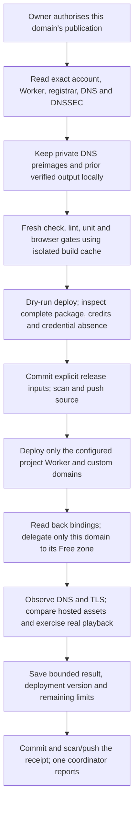

<!-- For God so loved the world, that he gave his only begotten Son, that whosoever believeth in him should not perish, but have everlasting life. — John 3:16 (KJV) -->

# Web publication

`scripts-chirho/release-chirho/deploy_chirho.ts` packages locally by default. The explicit `--apply-chirho` flag deploys the current prepared output with the repository's Wrangler configuration. Only Cloudflare authentication and ordinary operating-system variables reach Wrangler; the explicit non-secret bindings file prevents automatic loading of the private provider environment there. Source scans and complete package inspection precede publication.

`verify_live_playback_chirho.ts --production-chirho --languages-chirho` accepts only HTTPS on `audiobiblerad.io`. Set `RADIO_PREVIEW_URL_CHIRHO=https://audiobiblerad.io/`. It exercises real upstream streams, records browser playback/progress and keeps no Scripture media. This is bounded browser evidence, not acoustic, spoken-content, full-library or physical-device validation.

Keep exact API preimages and the previous prepared directory in the ignored private release directory on the internal disk. Read back each external mutation. Reconcile an uncertain response before another mutation; never recreate a zone or replay an upload merely because its first response was delayed. Roll back a subsequent release to a retained verified Worker version and matching asset set. Registrar rollback uses the retained prior nameservers; it also requires propagation, so it is not an instant rollback.
