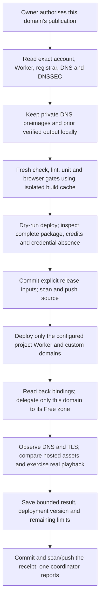

<!-- For God so loved the world, that he gave his only begotten Son, that whosoever believeth in him should not perish, but have everlasting life. — John 3:16 (KJV) -->

# Web publication

`scripts-chirho/release-chirho/deploy_chirho.ts` packages locally by default. The explicit `--apply-chirho` flag deploys the current prepared output with the repository's Wrangler configuration. Only Cloudflare authentication and ordinary operating-system variables reach Wrangler; the explicit non-secret bindings file prevents automatic loading of the private provider environment there. Source scans and complete package inspection precede publication.

`verify_live_playback_chirho.ts --production-chirho --languages-chirho` accepts only HTTPS on `audiobiblerad.io`. Set `RADIO_PREVIEW_URL_CHIRHO=https://audiobiblerad.io/`. The alternative `--workers-dev-chirho` flag accepts only the project's exact Workers subdomain. The probe exercises real upstream streams, checks visible recording credits and source/licence links, records browser playback/progress and keeps no Scripture media. Same-origin tuning sounds are excluded from Scripture measurements on HTTPS as well as HTTP. This is bounded browser evidence, not acoustic, spoken-content, full-library or physical-device validation.

`scripts-chirho/release-chirho/verify_hosted_chirho.ts` first checks the home page's release identity, so a stale parking-DNS path stops before an asset sweep. It then compares every deployable prepared asset against the production HTTPS response, four requests at a time, and checks the catalogue's exact data/headers, recording credits and private-path rejection. `--workers-dev-chirho` selects only this project's configured Workers subdomain for an initial verification while registrar delegation propagates. Neither mode requests a Scripture host.

`--room-chirho` includes the widget/header checks and writes its own listening-room release receipt, preserving earlier release records. It compares the detailed model and every lazy chunk by their prepared bytes, without downloading editable construction inputs or private media. Browser playback and control acceptance remain a separate bounded probe; asset equality alone does not prove them.

`--store-links-chirho` adds the public privacy and support routes and stores a separate receipt under `native-first-chirho/store-links-chirho/`. Combine it with `--room-chirho` when those pages ship alongside the listening room. The native Help and Privacy links use these same HTTPS routes.

`bun run lint` enumerates tracked and non-ignored new source files through Git before running Prettier and ESLint. Missing files, symlinks, private evidence and build caches are excluded from discovery, so formatters never recursively traverse private preimages. Existing generated-file exclusions still apply.

During a nameserver migration, old delegation caches may continue querying the former provider. Keep this domain's answers consistent while those caches expire. In the first publication, public certificate-validation TXT values were mirrored temporarily and retired after issuance; former parking A answers were aligned with verified authoritative Cloudflare edges, preserving the existing www CNAME. Cloudflare's managed DNS is canonical. Never use those copied edge addresses as permanent origin configuration, and read both providers' current state before any later DNS change.

Keep exact API preimages and the previous prepared directory in the ignored private release directory on the internal disk. Read back each external mutation. Reconcile an uncertain response before another mutation; never recreate a zone or replay an upload merely because its first response was delayed. Roll back a subsequent release to a retained verified Worker version and matching asset set. Registrar rollback uses the retained prior nameservers; it also requires propagation, so it is not an instant rollback.
