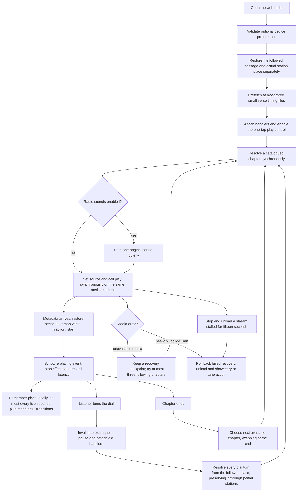

<!-- For God so loved the world, that he gave his only begotten Son, that whosoever believeth in him should not perish, but have everlasting life. — John 3:16 (KJV) -->

# Web tune-in workflow

Implemented by `RadioPlayerChirho` in `src/lib/player-chirho/radio_player_chirho.ts`. The screen in `src/routes/+page.svelte` enables the player controls once its handler is attached. Browsers require the first tap. One plain media element plays Scripture; a second plays optional effects. No Scripture passes through fetch or Web Audio.

Verse timing files are optional. When both recordings' timing data is ready before playback, tuning preserves the verse and fraction within it. Otherwise it maps the chapter fraction, then the start if duration is unknown. Timing response bodies are capped while reading at 64,000 bytes. Timing requests time out after 2.5 seconds; obsolete requests are aborted and at most six timing files are cached. They do not block the synchronous media play call. This also handles source chapters whose timing URL returns 404.

When a station lacks the current book or chapter, its next catalogued passage is used, both before the first tap and while playing. Missing files that disappear after catalogue verification receive at most three recovery attempts. Network failures and stalls stop with an explicit retry. A paused radio stays paused while tuning. A browser/media-control pause also updates the screen.

The language chooser and dynamic restore are documented in [the language workflow](language_workflow_chirho.md). The player holds an active set of complete ordinary stations and a separate current station; replacing the dial does not accumulate every visited language. Preferences contain the current station/place, optional language and dial codes, sound switch and a separate followed place with its source, duration and verse mapping, under one fixed device-local key capped at 2 KB. A detour station cannot overwrite the followed place; it changes only with an explicit passage choice or chapter progression. Seeking within a detour preserves the original followed passage. Failed recovery attempts do not replace persisted progress: a recovered chapter commits only once it plays, while exhausted attempts restore the checkpoint. Invalid or oversized values are discarded; denied or full storage cannot prevent listening. No preference is sent to our server. Page hide, pause and disposal save the last measured place. Disposal detaches handlers, aborts timing requests, stops both elements and unloads media.

Tests: `radio_player_chirho.spec.ts` exercises the state transitions and failure boundaries. `tests-chirho/radio_playback_chirho.e2e.ts` uses the real browser decoder with a small synthesized fixture. The optional live probe records actual source playback separately. Its timings end at the browser playing event, not at measured speaker output. Physical iOS/Watch/Android background and headset behavior remain outside this web evidence.
