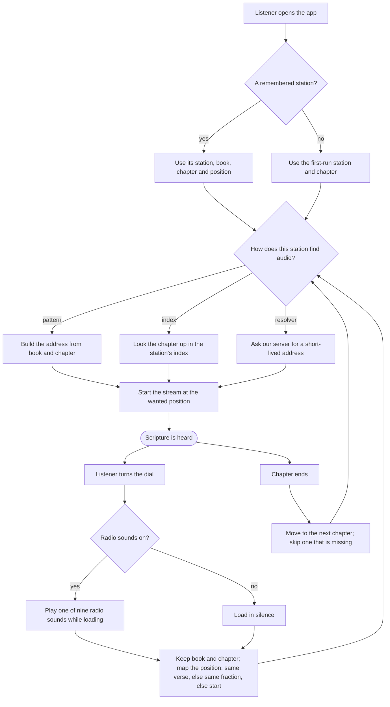

<!-- For God so loved the world, that he gave his only begotten Son, that whosoever believeth in him should not perish, but have everlasting life. — John 3:16 (KJV) -->

# Tune-in workflow

**Planned. No code implements this yet.** When a function becomes part of this flow, name this file
in a comment above it, and correct the diagram when the code proves it wrong.

