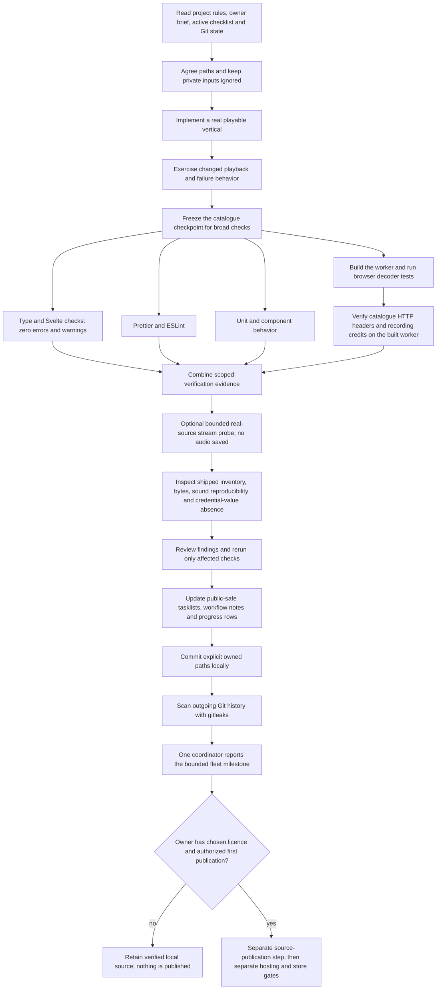

<!-- For God so loved the world, that he gave his only begotten Son, that whosoever believeth in him should not perish, but have everlasting life. — John 3:16 (KJV) -->

# Local verification and landing

`generate_worker_types_chirho.ts` gives each invocation a process-specific scratch configuration, so concurrent check and build processes cannot unlink each other's input. Two simultaneous `bun run gen:check` calls are part of its measured repair evidence. Generated binding types remain unchanged.

The player tests have been made to fail under deliberate violations of cancellation, reading-place continuity, recovery rollback and the recovery limit. The exact failures and restored source hash are recorded in the web evidence. The browser suite also covers a delayed JavaScript load, native pause-before-ended ordering, partial source coverage, a denied device store, and real decoder playback with original fixture bytes.

Language tests additionally cover lazy catalogue reads, size/time/cache bounds, merge behavior, stale language responses, dynamic station persistence, restore failure, explicit fallback and narrow-screen keyboard return. The language evidence retains three rendered refinement passes.

The optional live probe records four real upstream streams and checks that each media clock advances, that only Scripture remains active after loading, and that the media is unmuted. It measures navigation and gestures to the browser playing event. It does not establish acoustic latency, correct language perception, physical-device background behavior, store acceptance, a deployment or a release.

The build inventory includes the app, its small catalogue JSON shards and nine original short WAV effects. Source Scripture is streamed, never packaged. Compare configured credential values against the complete built payload without printing the values, then scan local commits before any publication. Private owner words, credentials and unsent outreach stay outside version control.
